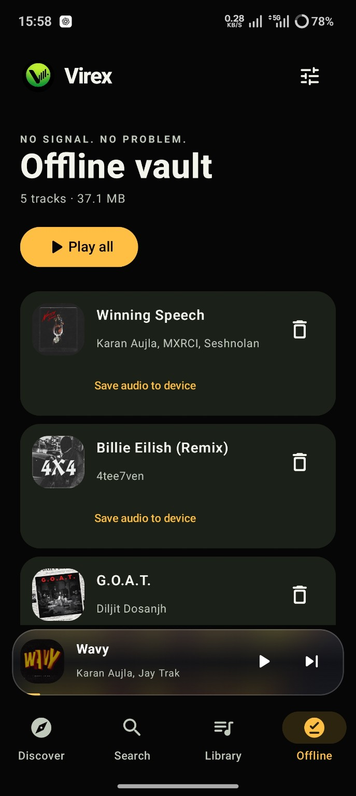

<div align="center">
  
  <h1>Virex Music</h1>
  <p><strong>Your music. Online and offline.</strong></p>
  <p>A native Android music app built with Kotlin, Jetpack Compose and Media3.</p>
  <p><a href="https://github.com/ogvirex/virex-music/releases/latest">Download APK</a> · <a href="https://ogvirex.github.io/virex-music/">Website</a> · <a href="https://github.com/ogvirex/virex-music/issues">Report an issue</a></p>
  <p>Android 8.0+ · Version 1.3.3 · MIT licensed</p>
</div>

## Listen, collect, take it offline

- **Discover & search** — category mixes, song search and recent queries.
- **Virex Radio** — extend playback from a seed track, with artist-search fallback.
- **Offline listening** — save individual songs or an entire playlist, with queued/progress/completed states; export saved audio to your device.
- **Lyrics** — synchronized, plain and cached lyrics when available.
- **Your library** — playlists, bulk text import, liked songs, listening history and most-played tracks.
- **Player controls** — editable queue, Play next, shuffle/repeat, seeking, media notifications and background playback.
- **Make it yours** — accent colors, quality preference, optional crossfade and audio visualizer.
- **Resume** — restore the last session paused at its saved position.

No sign-in or in-app advertising SDK is required. Playlists, listening records and offline audio are stored locally. Catalog, streaming and lyrics requests use external services; their availability and content vary. Quality is up to 320 kbps when supplied by the catalog.

## Screenshots

<p align="center">
  
  
  
  
  
</p>

Screenshots were supplied by the project owner. Track names, artwork and third-party catalog content remain the property of their respective owners; they are not bundled as music in the application.

## Install

Download the APK from [Releases](https://github.com/ogvirex/virex-music/releases/latest), then open it on Android 8.0 or newer. Version 1.3.3 uses the same official signing identity as 1.3.2 and can update it in place. Versions 1.3.1 and earlier need a fresh installation, which removes their local app data.

## Build from source

Requirements: JDK 17, Android SDK Platform 35 and Build Tools 35.0.0. The Gradle wrapper uses 8.11.1; AGP 8.9.1 and Kotlin 2.1.20 are pinned in source.

```sh
chmod +x gradlew
./gradlew testDebugUnitTest lintDebug assembleDebug
```

The debug APK is `app/build/outputs/apk/debug/app-debug.apk`. A fork's debug signing key differs from the official release key. Use your own signing key for your distributions; official private signing material is never part of this repository. `VIREX_SIGNING_PROPERTIES` may point to a private properties file with `storeFile`, `storePassword`, `keyAlias` and `keyPassword`; relative keystore paths resolve beside that properties file. With it configured, run `./gradlew assembleRelease`.

## Validation and known limits

The 1.3.3 release passed 28 host Android/Compose/Media3 tests and Android lint with zero errors. See [BUILD_STATUS.md](BUILD_STATUS.md) for scope and limitations. Physical-device behavior, hardware visualization and audio decoding/focus still need device testing.

The current music provider's suggestions route returned HTTP 500 during the release checks. Radio retains its artist-search fallback. Lyrics and catalog availability depend on external services.

## Contribute

See [CONTRIBUTING.md](CONTRIBUTING.md). For a bug report, include app version, Android version, device model and clear reproduction steps. Do not post credentials, private signing material or personal listening data.

## License and acknowledgments

Project code is available under the [MIT License](LICENSE). Dependencies retain their own licenses. The Gradle wrapper retains its Apache-2.0 notices. AndroidX/Compose/Media3, Kotlin, coroutines, WorkManager, Coil and OkHttp power the native application. See [NOTICE](NOTICE).
