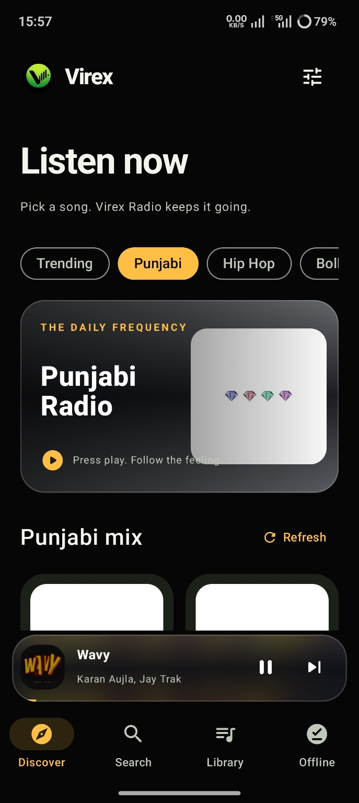
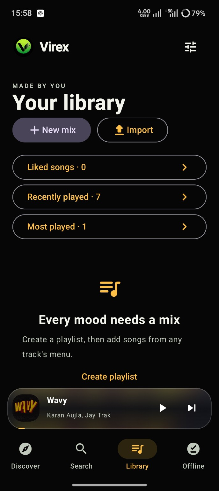
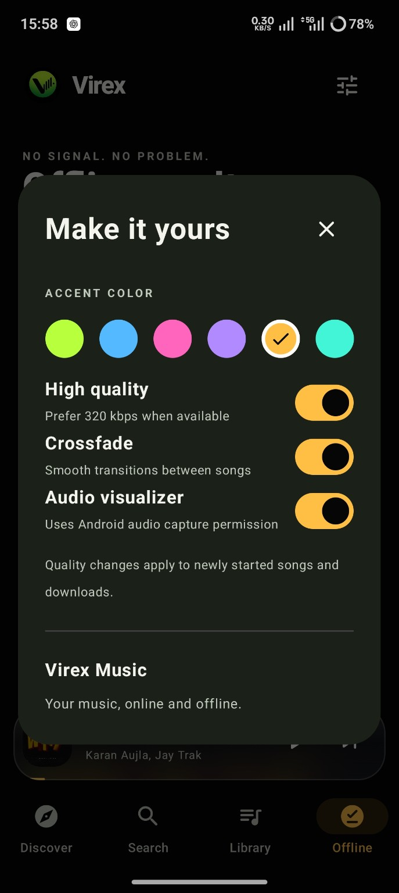

  
  <h1>Virex Music</h1>
  
<strong>Your music. Online and offline.</strong>

  
A native Android music app built with Kotlin, Jetpack Compose and Media3.

  
<a href="https://github.com/ogvirex/virex-music/releases/latest">Download APK</a> · <a href="https://ogvirex.github.io/virex-music/">Website</a> · <a href="https://github.com/ogvirex/virex-music/issues">Report an issue</a> · <a href="https://t.me/Virex_Devs">Telegram updates</a>

  
Android 8.0+ · Version 1.3.3 · MIT licensed

## Listen, collect, take it offline

- **Discover & search** — category mixes, song search and recent queries.
- **Virex Radio** — keep the music going with recommendations based on your selected track.
- **Offline listening** — save individual songs or an entire playlist, follow download progress and export saved audio to your device.
- **Lyrics** — synchronized, plain and cached lyrics when available.
- **Your library** — playlists, bulk text import, liked songs, listening history and most-played tracks.
- **Player controls** — editable queue, Play next, shuffle/repeat, seeking, media notifications and background playback.
- **Make it yours** — accent colors, quality preference, optional crossfade and audio visualizer.
- **Resume** — restore the last session paused at its saved position.

No sign-in or in-app advertising SDK is required. Playlists, listening records and offline audio are stored locally. Catalog, streaming and lyrics requests use external services; their availability and content vary. Quality is up to 320 kbps when supplied by the catalog.

## Screenshots

<table>
  <tr>
    <td align="center"> Discover</td>
    <td align="center"> Now playing</td>
    <td align="center"> Library</td>
  </tr>
  <tr>
    <td align="center"> Offline</td>
    <td align="center"> Settings</td>
    <td></td>
  </tr>
</table>

## Install

Download **Virex-Music.apk** from [Releases](https://github.com/ogvirex/virex-music/releases/latest), open it on your Android device, and follow the installation prompts.

**Requires Android 8.0 or newer.**

## Stay updated

Join [Virex Devs on Telegram](https://t.me/Virex_Devs) for app releases, project news, and announcements.

## Contribute

See [CONTRIBUTING.md](CONTRIBUTING.md). For a bug report, include app version, Android version, device model and clear reproduction steps. Do not post credentials, private signing material or personal listening data.

## License and acknowledgments

Project code is available under the [MIT License](LICENSE). Dependencies retain their own licenses. The Gradle wrapper retains its Apache-2.0 notices. AndroidX/Compose/Media3, Kotlin, coroutines, WorkManager, Coil and OkHttp power the native application. See [NOTICE](NOTICE).
